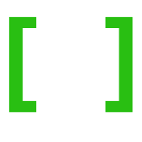
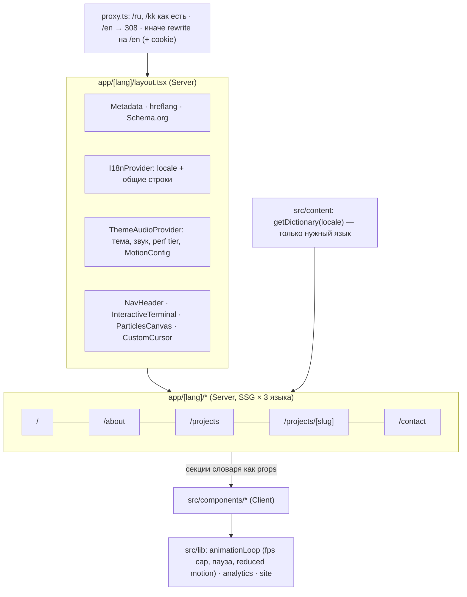

<p align="center">
  
</p>

<h1 align="center">daelijekPortfolio // Dias Yermek</h1>

<p align="center">
  <strong>Кибер-инженерное HUD-портфолио & Архитектурная витрина продакшн-проектов</strong><br>
  <em>Cyber-Engineering HUD Portfolio: Procedural Audio Synthesis, 60 FPS Canvas Shaders, Next.js 16 & Deep Technical Dossiers.</em>
</p>

<p align="center">
  <a href="#-о-проекте-и-концепции">Концепция</a> ·
  <a href="#-ключевые-инженерные-фичи">Фичи</a> ·
  <a href="#-архитектура-системы">Архитектура</a> ·
  <a href="#-технологический-стек">Стек</a> ·
  <a href="#-проекты-и-кейсы">Кейсы</a> ·
  <a href="#-быстрый-старт">Быстрый старт</a> ·
  <a href="#-контакты">Контакты</a>
</p>

<p align="center">
  
  
  
  
  
  
  
  
  
</p>

---

## ⚡ О проекте и концепции

Большинство сайтов-портфолио представляют собой статичные визитки, созданные по типовым шаблонам. **daelijekPortfolio** спроектирован с противоположным подходом: как **интерактивная бортовая операционная система инженера (Cyber-Engineering HUD)**.

Проект решает сразу две ключевые задачи:
1. **Демонстрация технической глубины и зрелости кода**: наглядное подтверждение владения современными стандартами фронтенда — от процедурного синтеза звуковых волн и математических 60 FPS шейдеров на Canvas до строгой серверной SEO-оптимизации и масштабируемого роутинга в Next.js App Router.
2. **Интерактивные детальные кейсы (Dossiers)**: каждый флагманский проект снабжен исчерпывающим разбором архитектуры, диаграммами потоков данных, замерами метрик и решениями сложных инженерных вызовов.

> **Статус деплоя:** Продакшн на Vercel · 100% покрытие мобильных экранов · Нулевой объем загружаемых аудиофайлов · Полная локализация на 3 языка (Казахский, Русский, Английский).

---

## 🎯 Для кого этот репозиторий

| Роль | Что здесь ценно и на что обратить внимание |
| --- | --- |
| **Tech Leads & CTO** | Чистота архитектуры, изоляция серверных и клиентских слоев Next.js, отсутствие техдолга, Turbopack-сборка за <1 сек, 0 внешних аудио-зависимостей. |
| **Frontend & Mobile Reviewers** | Кастомный Web Audio API синтезатор частот, delta-time нормализация физики анимаций, чистая адаптивность без дерганий, строгий i18n-пайплайн. |
| **Recruiters & HR-команды** | Подробная матрица компетенций по 8 секторам, история коммерческого опыта в EdTech, GovTech, FinTech и Web3, проверенные продуктовые результаты. |

---

## 🚀 Ключевые инженерные фичи

### 1. Процедурный синтезатор звука на Web Audio API (0 KB ассетов)
В проекте **полностью отсутствуют аудиофайлы** (`.mp3`, `.wav`). Все звуковые эффекты (тактильные щелчки, высокочастотные наведения, загрузочные аккорды, свипы открытия модалок) генерируются в реальном времени с помощью программных осцилляторов:
- Управление огибающими громкости (`exponentialRampToValueAtTime`).
- Динамический выбор типов волн: `sine`, `triangle`, `sawtooth`.
- Два переключаемых звуковых профиля: **Ambient / Lo-Fi** и **Digital Cyber / Retro Synthwave**.

### 2. Графический конвейер Canvas 60 FPS с Delta-Time нормализацией
- **Лазерный сканер текста реального времени (`TrueLaserScanner`)**: процедурное свечение, математический расчет пересечения лазерного луча с глифами шрифта, неоновые шлейфы.
- **3D Квантовая координатная матрица (`QuantumMatrixBackground`)**: перспектива трехмерной плоскости с волнообразным возмущением узлов по синусоидальным законам.
- **Интерактивное созвездие узлов (`ParticlesCanvas`)**:
  - *На десктопе:* физическая модель отталкивания частиц от курсора с динамическим сглаживанием координат и отрисовкой связей-созвездий.
  - *На смартфонах / тач-экранах:* система автоматически определяет отсутствие указателя мыши и переключается в **автономный режим орбитального дрейфа** — фоновые узлы оживают без дерганий и не создают паразитной нагрузки на event loop тач-событий.
- **Бинарный дождь матрицы (`CyberMatrixRain`)**: нормализованная по `dtModifier` кинематика символов, гарантирующая одинаковую скорость отрисовки на 60 Hz, 120 Hz и 144 Hz дисплеях.

### 3. Глубокие архитектурные кейсы (`/projects/[slug]`)
Для каждого флагманского проекта реализована интерактивная страница-досье:
- **Finance AI Manager** (React Native, Expo, FastAPI, Python, PostgreSQL).
- **RoleSieve** (Next.js 16, React 19, Tailwind 4, FastAPI, NLP — аналитика вакансий HeadHunter).
- **OpenGov.kz Portal** (стажировка в QB Solutions на Next.js; текущая версия — React 19 + Vite, i18next).
- **BerikWeb 3D Gallery** (HTML5, Vanilla JS, 3D Canvas, Retina Multilanguage).
- Каждое досье включает стек, целевую аудиторию, вызовы безопасности, метрики производительности и прямые ссылки на production/demo.

### 4. Интернационализация через URL (EN / RU / KK)
- Английский — на основных адресах (`/about`), русский и казахский — с префиксом (`/ru/about`, `/kk/about`).
- Страницы рендерятся на сервере **сразу на нужном языке** (`<html lang>`, заголовки, мета-теги); в браузер уходят только тексты текущего языка.
- `hreflang`-альтернативы и `x-default` на каждой странице, sitemap со всеми локалями.
- Выбранный язык запоминается (cookie) — по языку браузера сайт не перенаправляет: ссылка из английского CV всегда открывает английскую версию.
- Словари типизированы: русский и казахский проверяются против английского компилятором и тестами (одинаковые ключи, картинки, ссылки).

### 5. Динамические темы HUD
- **Obsidian White** (`#FFFFFF`) — строгий высококонтрастный режим.
- **Cyber Cyan** (`#00F3FF`) — неоновый бирюзовый sci-fi.
- **Acid Green** (`#00FF9F`) — киберпанк / терминал.
- **Amber Gold** (`#FFB800`) — теплый янтарный HUD.
- **Crimson Red** (`#FF0055`) — агрессивный системный алерт.

### 6. SEO и OpenGraph
- `canonical`, `hreflang`, OpenGraph и Twitter-карточки для каждой страницы на каждом языке.
- Превью 1200×630 для сайта и каждого кейса (`npm run og:generate`).
- [`app/sitemap.ts`](app/sitemap.ts), [`app/robots.ts`](app/robots.ts), разметка **Schema.org** (`Person`, `ProfilePage`).

### 7. Доступность и уважение к настройкам
- `prefers-reduced-motion`: статичные фоны, без инерционного скролла и автопрокрутки.
- Терминал, лайтбокс и стартовый экран — модальные диалоги с ловушкой и возвратом фокуса; всё управляется с клавиатуры.
- Контраст текста ≥ 4.5:1 во всех пяти темах.

---

## 🏗 Архитектура



| Директория | Роль |
| --- | --- |
| `app/[lang]/` | Маршруты всех языков: серверные страницы, метаданные, localized 404 |
| `proxy.ts` | Маршрутизация языков (Next.js 16 Proxy) |
| `src/content/` | Типизированные словари `en`/`ru`/`kk` и серверный загрузчик |
| `src/i18n/` | Конфиг языков, `I18nProvider`, хуки ссылок и переключения языка |
| `src/components/` | Клиентские компоненты по разделам (`home`, `about`, `project`, `navigation`, `terminal`, …) |
| `src/lib/animationLoop.ts` | Общий rAF-движок: кап fps по tier, пауза вне экрана/в фоне, единый шаг времени |
| `src/audio/soundEffects.ts` | Процедурный синтез звука (Web Audio API, 0 KB ассетов) |
| `tests/unit`, `tests/e2e` | Vitest (контент, i18n, команды терминала, аналитика) и Playwright |

---

## 🛠 Технологический стек

```text
├── Фреймворк:        Next.js 16 (App Router, Turbopack, Proxy)
├── Язык:             TypeScript 5 (strict)
├── UI:               React 19, Tailwind CSS 3.4, Framer Motion
├── Графика и звук:   Canvas 2D, Web Audio API
├── Изображения:      next/image (AVIF/WebP), sharp-скрипты оптимизации
├── Аналитика:        Amplitude (ленивая загрузка, session replay 10%)
├── Тесты:            Vitest, Playwright
└── CI:               GitHub Actions, Lighthouse CI, Dependabot
```

---

## 💻 Быстрый старт

Требования: Node.js ≥ 22.6.

```bash
git clone https://github.com/Daelijek/daelijekPortfolio.git
cd daelijekPortfolio
npm install
npm run dev            # http://localhost:3000
```

| Команда | Назначение |
| --- | --- |
| `npm run build` / `npm start` | Продакшн-сборка и запуск |
| `npm run lint` / `npm run typecheck` | ESLint / TypeScript |
| `npm test` | Unit-тесты (Vitest) |
| `npm run test:e2e` | E2E-тесты (Playwright; локально — установленный Chrome, нужен `npm run build`) |
| `npm run images:optimize -- <файлы>` | Перевод изображений в WebP с ограничением ширины |
| `npm run og:generate` | Пересборка OpenGraph-превью после смены обложек или фото |

**Добавить кейс:** запись в `projects.featured` во всех трёх словарях `src/content/locales/*.ts` (TypeScript и тесты подскажут, если что-то пропущено) → картинки в `public/assets/projects/<slug>/` → `npm run og:generate`. Страницы, sitemap и hreflang появятся автоматически.

---

## 📊 Производительность

Честные замеры Lighthouse (mobile, локальный прод-сервер) и история изменений — в [`docs/perf-baseline.md`](docs/perf-baseline.md).

| Метрика | Значение |
| --- | --- |
| Performance (mobile) | 86–89 |
| Accessibility | 100 |
| Best Practices | 96–100 |
| SEO | 100 |
| Вес страницы | ~0.4–0.5 MB (было до 7 MB) |
| Аудио-ассеты | 0 KB (процедурный синтез) |

---

## 👨‍💻 О разработчике

**Диас Ермек (Dias Yermek / daelijek)**  
*Middle Frontend & Mobile Software Engineer*  
📍 Астана, Казахстан (UTC+5) · Доступен для предложений (Full-time / Remote / Contract)

- **Образование:** Astana IT University — *Software Engineering*
- **Специализация:** Высоконагруженные веб-приложения на **Next.js & TypeScript**, кроссплатформенная мобильная разработка на **Flutter & React Native**.
- **Продуктовый трек-рекорд:**
  - **TrustMe:** Разработка и поддержка смарт-контракт платформы для **1.5M+ пользователей**.
  - **BeyimTech:** Разработка мобильного приложения интеллектуальной адаптивной системы обучения (Astana Hub), запущенного в **20+ школах**.
  - **OpenGov.kz:** Инженерная поддержка портала открытых данных государственного управления.

---

## 📬 Контакты и каналы связи

- ✈️ **Telegram:** [@daelijek_og](https://t.me/daelijek_og) *(самый быстрый ответ)*
- 💼 **LinkedIn:** [dias-yermek](https://www.linkedin.com/in/dias-yermek/)
- 🐙 **GitHub:** [@Daelijek](https://github.com/Daelijek)
- 📧 **Email:** [dias1605ermek@gmail.com](mailto:dias1605ermek@gmail.com)
- 🌐 **Live Website:** [daelijek-portfolio.vercel.app](https://daelijek-portfolio.vercel.app)

---

<p align="center">
  <sub>© 2026 Dias Yermek (daelijek) · Designed & Engineered with Next.js 16, Tailwind CSS & Web Audio API</sub>
</p>
